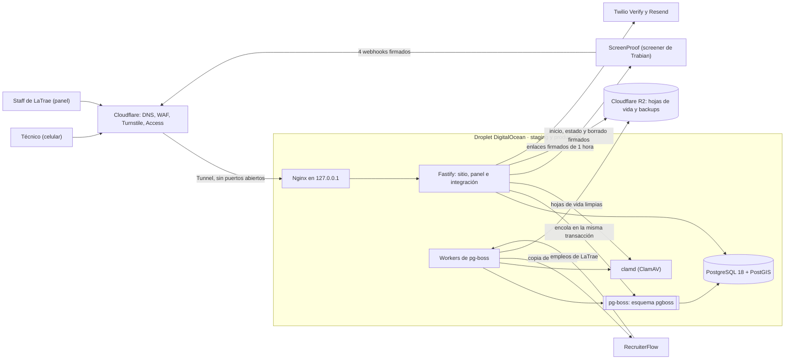

# DieselJobsUSA

> **DieselJobsUSA.com** is a job board built only for diesel and heavy-equipment technicians in the United States. Technicians sign up, upload a resume and take an automated skills interview (ScreenProof, by Trabian) that returns a level the technician never sees; the site keeps every record in its own PostgreSQL and copies candidates to the client's recruiting system. Private repository of TL Turner Holdings Inc.; project documents are in Spanish, client handoff documents in English.

## Propósito

- Una bolsa de empleo con marca propia para técnicos diésel y de equipo pesado, de TL Turner Holdings (LaTrae Consulting Group).
- Arma un roster propio de candidatos verificados: registro, hoja de vida, entrevista automática externa con nivel A/B/C que **nunca** se le muestra al técnico.
- Sprint 1 (este): mockup de toda la plataforma, base técnica, seis páginas, registro, conexión con el screener y panel del staff.

## Estado

Al 30 de octubre de 2026: tareas T-01 a T-04b hechas (esqueleto, base de datos con roles separados, primitivas de seguridad, modelo de datos de 34 tablas y una revisión interna de cimientos); el mockup (T-37) va por las tandas 1 a 3 de 7; la siguiente tarea es T-05 (vocabulario). No hay servidor ni CI todavía: el reloj de 15 días hábiles del Sprint 1 arranca cuando lleguen las cuentas, los archivos de marca y el endpoint de prueba del screener. Detalle y cifras en [`docs/00_contexto.md`](docs/00_contexto.md) §6.

## Arquitectura de un vistazo



Piezas y protocolos, una por una: [`docs/plan/01_arquitectura.md`](docs/plan/01_arquitectura.md) §4. Lo construido hoy es la app con su base local; Nginx, el túnel, R2 y las integraciones llegan con las tareas de 04.

## Estructura de carpetas

| Carpeta | Qué contiene |
|---|---|
| `src/` | La aplicación (Fastify 5, TypeScript estricto) |
| `src/config/` | `env.ts`: variables de entorno validadas con zod; la app no arranca si falta una (SEC-61) |
| `src/db/` | Cliente de PostgreSQL, esquema Drizzle (`schema/`, un archivo por grupo de tablas), migraciones SQL (`migrations/`) y la comprobación del anillo de claves al arrancar |
| `src/domain/` | Lógica de negocio sin HTTP; hoy `vocabulary/normalize-alias.ts` |
| `src/logging/` | pino con limpieza de datos personales (SEC-73) |
| `src/public-site/` | Rutas del sitio público; hoy `GET /healthz` |
| `src/security/` | Firma HMAC, anillo de claves, tokens, `safeRedirect`, CSP |
| `tests/` | Pruebas que no viven junto al código: `schema/` (contra la base real), `scripts/`, `mockup/`, `helpers/`, `setup/` |
| `mockup/` | El mockup estático de toda la plataforma (TSX + Tailwind, sin base de datos); fuera del paquete de producción ([`05_mockup.md`](docs/plan/05_mockup.md)) |
| `scripts/` | Migraciones de pg-boss, `db-reset` (solo local) y el `prepare` que activa gitleaks |
| `infra/` | Hoy `db/roles.sql` (roles por entorno) e `init-local.sh`; luego Nginx, cloudflared, systemd y chequeos de despliegue (T-26) |
| `vocabulary/` | El vocabulario del cliente en JSON; el código nunca lo escribe a mano |
| `docs/` | Contexto y plan (índice abajo) |
| `.githooks/` | `pre-commit` con gitleaks (SEC-87) |
| `.claude/` | Permisos de Claude Code para este repositorio |

Las tareas siguientes agregan `fake-screener/` (T-06), `src/integrations/`, `src/jobs/`, `src/panel/`, `src/views/` y `.github/workflows/` (T-23); el mapa completo está en 03 §2.4.

## Requisitos

| Herramienta | Versión | Cómo instalarla |
|---|---|---|
| Node.js | **24.22.x** (fijada en `.node-version`; `engine-strict` rechaza otra) | Con [fnm](https://github.com/Schniz/fnm), que lee `.node-version`: Windows `winget install Schniz.fnm`; macOS `brew install fnm`; Linux `curl -fsSL https://fnm.vercel.app/install \| bash`. Luego, en la carpeta: `fnm install` y `fnm use`. Con nvm: `nvm install 24.22.2` y `nvm use 24.22.2` (nvm no lee `.node-version`) |
| npm | 11.19 o mayor | Viene con Node 24.22; trae `min-release-age` |
| Docker | Docker Desktop (Windows con WSL 2, macOS) o Docker Engine con el plugin compose (Linux) | Levanta PostgreSQL 18 + PostGIS y ClamAV en local |
| gitleaks | 8.30.x | Windows `winget install Gitleaks.Gitleaks` (abrir una terminal nueva); macOS `brew install gitleaks`; Linux, el binario de la release de GitHub |
| Git | cualquiera reciente | — |

## Puesta en marcha local

Solo comandos que existen hoy, en este orden.

1. **Node.** `fnm install` y `fnm use` dentro de la carpeta (o el equivalente con nvm).
2. **Dependencias.** `npm ci`. El `.npmrc` fija `ignore-scripts=true` (ningún paquete corre scripts al instalar, SEC-84) y `min-release-age=7` (npm no resuelve versiones con menos de 7 días, SEC-85). Nunca `npm install` para instalar lo que ya está en el lockfile (SEC-83).
3. **Hook de secretos, una vez por clon.** Con `ignore-scripts`, `prepare` no corre solo: instalar gitleaks y correr `npm run prepare`, que comprueba que `gitleaks version` responde y activa `.githooks` (`core.hooksPath`). Si gitleaks no está, falla y no activa nada (SEC-87).
4. **Variables.** Copiar `.env.example` a `.env` y ajustar. El `.env` nunca se sube (SEC-70). La app no arranca si falta una variable o no cumple su regla, y el error nombra la variable sin mostrar su valor (SEC-61).
   - `SCREENER_IN_SECRETS`, `SCREENER_OUT_SECRET` y `PHONE_HASH_KEYS` llevan el formato `id:secreto[,id:secreto]` (texto opaco de al menos 32 bytes por secreto, sin `,`); `PHONE_HASH_ACTIVE` es uno de los ids de `PHONE_HASH_KEYS`. Generar cada valor con:
     ```
     node -e "console.log(require('node:crypto').randomBytes(32).toString('base64url'))"
     ```
   - Los valores locales son inventados y distintos de los de staging y producción; los reales los custodia Sergio fuera del repositorio (02 §4.15). El marcador `GENERAR` de `.env.example` es corto a propósito: si alguien olvida reemplazarlo, la app se niega a arrancar.
5. **Base de datos y ClamAV.** `docker compose up -d` levanta PostgreSQL 18 + PostGIS (`127.0.0.1:5432`) y ClamAV (`127.0.0.1:3310`). La primera vez, `infra/db/init-local.sh` crea las bases `dju_dev` y `dju_test`, cada una con su rol de app y su rol de migración (`infra/db/roles.sql`). Ese init solo corre con el volumen vacío; para repetirlo: `docker compose down -v` (borra los datos locales) y `docker compose up -d`.
   - Listo cuando `docker compose ps` muestra los dos servicios `(healthy)`. ClamAV puede tardar varios minutos la primera vez mientras baja firmas (`docker compose logs -f clamav`) y usa de 1 a 1,5 GB de memoria.
   - Las contraseñas de `compose.yaml` e `init-local.sh` son solo de desarrollo local: los puertos están publicados en `127.0.0.1` y nunca hay datos reales (02, SEC-70).
6. **Migraciones, antes de arrancar la app.** `npm run db:migrate` corre `drizzle-kit migrate` y luego crea o migra el esquema `pgboss`, siempre con el rol de migración (`DATABASE_URL_MIGRATE`, SEC-68). Repetirlo no hace nada.
7. **Arrancar.** `npm run dev` levanta la app en `http://127.0.0.1:3000`; `curl http://127.0.0.1:3000/healthz` responde `{"status":"ok"}`.
8. **Mockup (opcional).** `npm run mockup:dev` lo sirve en `http://127.0.0.1:4173`. Para las capturas (`npm run mockup:shots`), una vez: `npx playwright install chromium`.

## Pruebas

```
npm test                                   # Vitest: unitarias, de ruta y de base de datos
npm run typecheck                          # tsc --noEmit
npm run lint                               # Biome
npm audit --omit=dev --audit-level=high    # vulnerabilidades de producción
```

- `npm test` necesita los contenedores arriba y el `.env` con `TEST_DATABASE_URL` y `TEST_DATABASE_URL_MIGRATE`. Antes de correr, migra `dju_test` con el rol de migración. Las pruebas de base corren contra PostgreSQL real y **fallan** (no se saltan) si la base no está.
- Las pruebas que vigilan un control llevan su identificador en el nombre: `grep -rn "SEC-67" src tests`.
- Las del mockup (`tests/mockup/`) construyen el mockup completo en una carpeta temporal y revisan noindex, cero scripts, enlaces internos, textos prohibidos y colores.

## Comandos

| Comando | Qué hace |
|---|---|
| `npm run dev` | App con recarga, leyendo `.env` con `--env-file` |
| `npm run build` / `npm start` | Compila a `dist/` y la arranca |
| `npm test` | Vitest |
| `npm run typecheck` | `tsc --noEmit` |
| `npm run lint` / `npm run format` | Biome: revisa / corrige formato e imports |
| `npm run prepare` | Activa el hook de gitleaks |
| `npm run db:migrate` | Migraciones de Drizzle y esquema de pg-boss, con el rol de migración |
| `npm run db:generate` | `drizzle-kit generate`: SQL nuevo en `src/db/migrations/` a partir de `src/db/schema/` |
| `npm run db:reset` | Solo local (`APP_ENV` development o test, base `dju_dev` o `dju_test`): borra lo migrado y vuelve a migrar |
| `npm run mockup:build` / `mockup:dev` / `mockup:shots` | Construye, sirve o captura el mockup (05 §6) |

Llegan con sus tareas: `vocab:load` (T-05), `fake-screener` (T-06), `seed` y `zip:load` (T-22), `verify` (T-23), `e2e` (T-25).

## Convenciones

- **Una tarea de `04_tareas.md` = un commit** con su identificador al inicio (`T-04: modelo de datos completo`) y las pruebas en el mismo commit. Commits por ruta, nunca `git add -A`.
- **Controles `SEC-nn`**: cada control de `02_seguridad.md` que una tarea toca tiene su prueba nombrada con el identificador, y 02 recibe la nota "Implementado en T-xx".
- **Idioma**: español sencillo en documentos, comentarios y mensajes de commit; inglés en nombres técnicos, campos, eventos y en `docs/handoff/` (la entrega al cliente).
- **Datos**: solo inventados fuera de producción (`@example.com`, teléfonos `+1 555 01xx`).
- **Dependencias**: versiones exactas; la revisión SEC-88 se anota en 01 §3 antes de agregar un paquete.

## Documentación

| Documento | Qué tiene |
|---|---|
| [`docs/00_contexto.md`](docs/00_contexto.md) | **Empezar aquí.** Qué pidió el cliente, qué se acordó, por qué se planificó así, cómo se trabaja, estado, glosario y preguntas abiertas |
| [`docs/plan/01_arquitectura.md`](docs/plan/01_arquitectura.md) | Decisiones del cliente y técnicas, stack con versiones y revisiones SEC-88, piezas, entornos, riesgos |
| [`docs/plan/02_seguridad.md`](docs/plan/02_seguridad.md) | Modelo de amenazas y los 88 controles `SEC-nn`, plan de incidentes, lista antes de publicar |
| [`docs/plan/03_backend.md`](docs/plan/03_backend.md) | Modelo de datos, rutas, flujos de webhooks y registro, trabajos, integraciones, vocabulario |
| [`docs/plan/04_tareas.md`](docs/plan/04_tareas.md) | Plan por tareas con aceptación, pruebas y horas; el verifier |
| [`docs/plan/05_mockup.md`](docs/plan/05_mockup.md) | El mockup: tandas, reglas e inventario de pantallas |
| `docs/context/` | Fuentes del cliente (contrato, especificaciones, correspondencia). **Privada: no está en el repositorio** |
| `docs/ops/`, `docs/handoff/` | Operación (T-23, T-26, T-34) y entrega en inglés (T-48). Todavía no existen |

`docs/plan/` manda: si el código y el plan no coinciden, se para y se corrige uno de los dos.

## Desarrollo asistido por IA

El código lo escribe Sergio Duran con Claude Code. Cómo se gobierna:

- **[`CLAUDE.md`](CLAUDE.md)** es el contrato de la herramienta: reglas fijas "nunca" y "siempre" (las mismas de 02 §6), reglas de dependencias, una tarea por sesión, parar y preguntar si algo contradice el plan.
- **`.claude/settings.json`** le niega a la herramienta leer el `.env` y algunos comandos. Solo aplica a Claude Code; una persona no queda frenada por él.
- **Las pruebas `SEC-nn`** son la forma de comprobar que lo escrito cumple el plan, y van en el mismo commit que el código.
- **El verifier**: hoy son los cuatro comandos de "Pruebas" más el hook de gitleaks; con T-23 pasa a CI (`npm run verify`, greps de seguridad, edad de dependencias, gitleaks en CI, velocidad de páginas). Hasta entonces nada corre solo en el servidor de Git.

Qué garantiza y qué no este método: [`docs/00_contexto.md`](docs/00_contexto.md) §5.

## Seguridad

El plan defensivo completo está en [`docs/plan/02_seguridad.md`](docs/plan/02_seguridad.md): controles por área (§4), plan de incidentes (§5), reglas fijas (§6) y lista de revisión antes de cada publicación (§7). Si encuentras una vulnerabilidad o un secreto en el repositorio, **no abras un issue público ni lo comentes en un pull request**: escríbele directamente a Sergio Duran o al dueño del repositorio en la organización de TL Turner Holdings. Un secreto que llegó a un commit se trata como filtrado y se rota (02 §5.1).

## Propiedad

Todo el código y el trabajo pertenecen a **TL Turner Holdings Inc.** Repositorio privado; no se distribuye ni se reutiliza fuera del proyecto.
